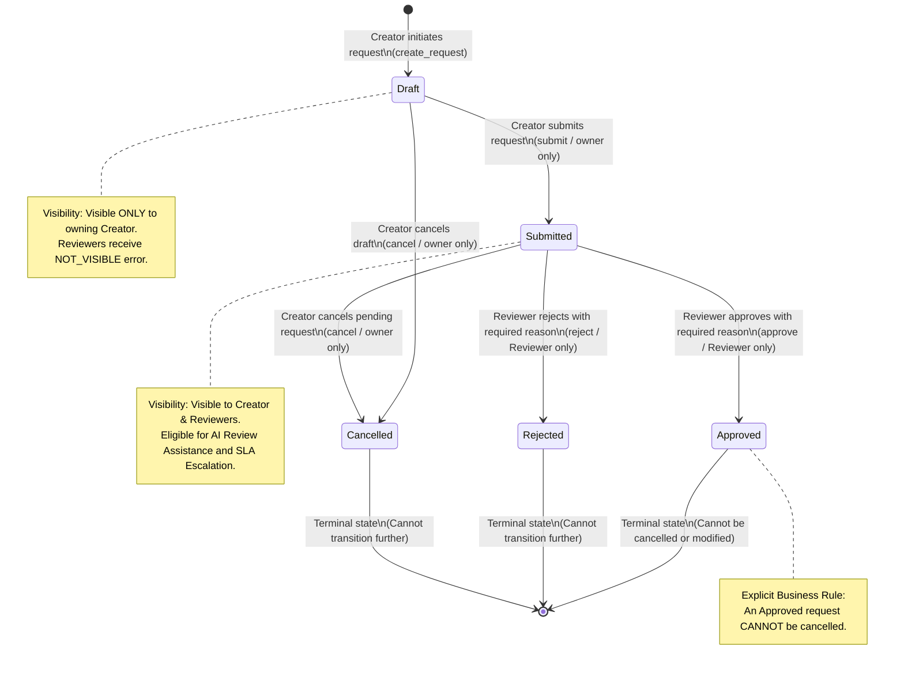

# System Architecture: Prewise Request Approval Flow

This document details the architectural topology, data flow, security boundaries, and state transition machine of the Prewise Request Approval system.

---

## 1. End-to-End System Flowchart

The diagram below illustrates the separation between untrusted AI agents, least-privilege toolboxes, the central orchestrator, and the deterministic SQLite state machine.

```mermaid
flowchart TD
    subgraph Users["Human Actors"]
        Creator["Creator (Alice / Bob)"]
        Reviewer["Reviewer (Rita)"]
    end

    subgraph UI["Streamlit Presentation Layer (app/ui.py)"]
        CreatorView["Creator Workspace\n(Intake, Drafts, Quality Check)"]
        ReviewerView["Reviewer Workspace\n(Pending Queue, AI Recs, Decision Checkpoint)"]
    end

    subgraph Orchestration["Central Orchestrator (app/orchestrator.py)"]
        GuardrailScanner["Guardrail Scanner (app/guardrails.py)\n- Regex Injection Filter\n- Breakout Sanitizer </request_data>"]
        OrchestratorCore["Orchestrator Engine\n- Coordinates Agents\n- Enforces Human Checkpoints\n- Handles Fallbacks"]
    end

    subgraph Agents["AI Advisory Layer (Pure Structured LLM)"]
        IntakeAgent["Intake Agent (app/agents.py)\nExtracts Title, Description,\nMissing Fields, Follow-ups"]
        QualityAgent["Quality-Check Agent (app/agents.py)\nClarity (1-5), Completeness (1-5),\nSuggestions, Risks"]
        ReviewAgent["Review-Assist Agent (app/agents.py)\nSummary, Risk (1-5), Priority,\nRecommendation, Injection Flag"]
    end

    subgraph Toolboxes["Least-Privilege Toolboxes (app/tools.py)"]
        IntakeTools["IntakeTools\nAllowed: [create_request, get_request]\nBlocked: [submit, transition]"]
        ReviewTools["ReviewAssistTools\nAllowed: [get_request ONLY]\nBlocked: [ALL MUTATIONS & TRANSITIONS]"]
    end

    subgraph DeterministicCore["Deterministic State Machine (Single Validator)"]
        Service["RequestService (app/service.py)\nAtomic UPDATE ... WHERE status = expected"]
        Rules["RULES Registry (app/rules.py)\nRole, Status, Owner, Valid Transitions"]
        SQLiteDB[(SQLite Database\nrequests, request_history)]
    end

    subgraph Observability["Audit & Notification Subsystems"]
        AuditLog[(agent_audit_log table\nAll agent calls, tokens, latency, status)]
        NotifManager[(notifications table\nConsole alerts & persistent feed)]
        EscalationDaemon["Escalation Daemon\nFlags requests pending > 24h SLA"]
    end

    %% User to UI
    Creator -->|Conversational Input / Actions| CreatorView
    Reviewer -->|Approve / Reject + Reason| ReviewerView

    %% UI to Orchestration
    CreatorView -->|handle_intake, check_quality, submit, cancel| GuardrailScanner
    ReviewerView -->|assist_review, human_decision| GuardrailScanner
    GuardrailScanner --> OrchestratorCore

    %% Orchestrator to Agents
    OrchestratorCore -->|Wrapped <request_data>| IntakeAgent
    OrchestratorCore -->|Wrapped <request_data>| QualityAgent
    OrchestratorCore -->|Wrapped <request_data>| ReviewAgent

    %% Agents & Toolboxes
    IntakeAgent -.->|Read & Create Draft| IntakeTools
    ReviewAgent -.->|Read Only| ReviewTools

    %% Orchestrator to State Machine
    OrchestratorCore -->|transition_request(actor, id, action)| Service
    Service --> Rules
    Service --> SQLiteDB

    %% Observability taps
    OrchestratorCore -->|Log every event| AuditLog
    OrchestratorCore -->|Dispatch alerts| NotifManager
    Service -->|Status change events| AuditLog
    EscalationDaemon -.->|Poll Submitted requests| Service
    EscalationDaemon -->|SLA Breach Alert| NotifManager
```

---

## 2. Request Lifecycle State Diagram

All lifecycle state transitions pass exclusively through `RequestService.transition_request()`. No direct database writes or agent overrides are permitted.



---

## 3. Security Boundaries and Invariants

1. **The AI Suggests; A Deterministic Backend Decides:**
   - Agents output pure structured Pydantic schemas.
   - Status changes require an explicit call to `transition_request` by an authenticated human user.
2. **Actor Injection:**
   - The `User` object is frozen and injected by Python backend code.
   - If an agent or client attempts to pass `actor` or `actor_id` in tool parameters, it is discarded.
3. **Physical Capability Restriction:**
   - `ReviewAssistTools` contains only `get_request`. Even if an adversary completely hijacks the LLM via prompt injection, the LLM physically lacks any tool to approve or alter status.
4. **Mandatory Human-in-the-Loop Checkpoint:**
   - The final transition to `Approved` or `Rejected` requires a human Reviewer to supply a non-empty textual justification.
